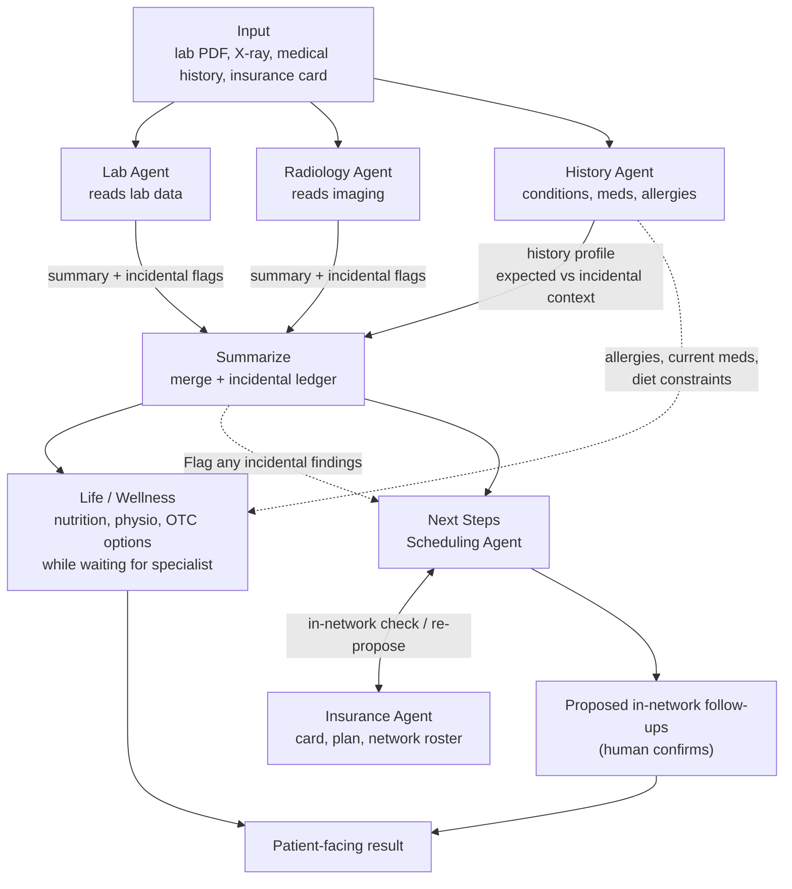

# CareRelay

A multi-agent navigator that turns a patient's lab PDF, X-ray, medical history and insurance card into a plain-language summary, budget-friendly wellness options to use while waiting, and in-network specialist follow-ups for both the expected and the incidental findings. Built for the AWS Austin Agentic AI Hackathon, Track 1 (Caregivers Challenge), on Amazon Bedrock, AgentCore and Strands Agents.

> **Prototype only.** CareRelay uses synthetic or public data and is not a clinical system or medical advice. See [docs/SAFETY.md](docs/SAFETY.md).

## Orchestration

Lab, Radiology and History run in parallel. The History Agent turns the patient's medical history (conditions, medications, allergies, procedures) into a profile that tells Summarize which abnormal results are expected for a known condition and which are truly incidental. Summarize merges everything, keeps a ledger of incidental findings, and fans out to Wellness (while waiting) and to Next Steps, where the Insurance and Scheduling agents collaborate to find in-network specialists.



## Inputs

1. **PDF of lab results** (synthetic, rendered from MIMIC-IV demo or Synthea data).
2. **X-ray** (chest radiograph from a public set such as NIH ChestX-ray14).
3. **Medical history** (synthetic: a Synthea FHIR bundle, a MIMIC-IV demo patient's diagnoses and prescriptions, or a short typed intake form with conditions, medications, allergies and past procedures).
4. **Insurance card** (synthetic image; no verified public card dataset exists).

The repo ships 10 synthetic cases in [data/](data/README.md): a radiology report PDF, lab PDF and medical history PDF per patient (PCP health summary, or a patient-typed questionnaire when there is no PCP), FHIR-shaped `Patient`/`Coverage`/history, intake answers, and a hidden answer key, plus a mocked plan and Austin-area provider network with deterministic tools (`find_providers`, `find_slots`, `estimate_cost`, ...). Scenarios are indexed in [data/CASES.md](data/CASES.md). The cases carry radiology *reports*, not X-ray images, and coverage as JSON, not card images.

## Agents

| Agent | Inputs | Tools / data | Outputs |
|---|---|---|---|
| Lab Agent | Lab PDF | Bedrock multimodal model via Converse, Textract TABLES fallback, deterministic range comparator | Typed lab rows, abnormal and critical flags, incidental anomalies, short summary |
| Radiology Agent | X-ray image | TorchXRayVision scores, Bedrock vision model for narrative | Label scores, findings narrative, incidental anomalies, short summary |
| History Agent | Medical history (FHIR bundle, CSV rows or typed intake) | FHIR Condition/MedicationRequest/AllergyIntolerance parsing, Comprehend Medical InferICD10CM and InferRxNorm for free text | `HistoryProfile`: coded conditions, active meds, allergies, procedures, existing specialists |
| Summarize | Lab, Radiology and History outputs | Typed finding schema, critic pass, expected-vs-incidental rules | Merged record, incidental ledger, routes to Wellness and Next Steps |
| Wellness Agent | Summarize record plus `HistoryProfile` | openFDA labels, USDA FoodData Central, NHLBI DASH, CDC activity guidance | Budget nutrition plan, physio steps, OTC options filtered by allergies, current meds and conditions |
| Insurance Agent | Insurance card image, specialty request | Bedrock vision model, payer lookup, Plan-Net directory or synthetic roster | Member and plan fields, in-network roster, network yes/no per candidate |
| Scheduling Agent | Findings mapped to specialties, in-network roster, existing specialists from history | NPI Registry, HAPI FHIR Slot and Appointment | Candidate specialists (existing ones first), `proposed` Appointment resources |

## Quickstart

1. Join the event and verify your account: [docs/AWS_SETUP.md](docs/AWS_SETUP.md).
2. Use the bundled synthetic cases in [data/](data/README.md); see [docs/DATASETS.md](docs/DATASETS.md) for X-ray images and other external sources.
3. Read the design: [docs/ARCHITECTURE.md](docs/ARCHITECTURE.md), then follow the build order in [docs/TODO.md](docs/TODO.md).
4. Run what exists so far:

```bash
uv venv .venv && uv pip install --python .venv/bin/python -e ".[dev]"
.venv/bin/python -m pytest -q tests data/tests
.venv/bin/python -m carerelay.history --pdf data/output/case_001/history.pdf --no-llm
.venv/bin/python scripts/eval_history.py --offline
```

The History Agent is implemented; see [docs/HISTORY_AGENT.md](docs/HISTORY_AGENT.md). Other agents follow the same package layout under `src/carerelay/`.

## Demo script (3 beats)

1. **Upload.** One synthetic patient: lab PDF, chest X-ray, medical history and insurance card. Show Lab, Radiology and History streaming in parallel. History surfaces a known condition and an allergy; Lab and Radiology each flag one anomaly.
2. **Merge and wait.** Summarize shows one abnormal value marked "expected, known condition" and one marked incidental in the ledger, with evidence and uncertainty. Wellness returns budget nutrition, physio and label-grounded OTC options, with one option visibly excluded because of the history allergy, under a clinician-review banner.
3. **Follow up.** Next Steps and Insurance trade proposals until in-network specialists are found for the expected and the incidental finding. A `proposed` appointment appears and waits for human confirmation.

## Safety disclaimer

Synthetic or public data only. CareRelay is a hackathon prototype, not a clinical system, and nothing it outputs is medical advice, diagnosis or a prescription. Red-flag values always require human confirmation. Details in [docs/SAFETY.md](docs/SAFETY.md).

## Repo layout

```text
.
├── README.md
├── pyproject.toml                      # package: carerelay (src layout)
├── requirements.txt
├── src/carerelay/
│   ├── service.py                      # service.handle(request) -> report: the one entry point every lane calls
│   └── history/                        # History Agent: schema, parsers (PDF, FHIR, MIMIC, intake), risk flags, tools, agent, CLI
├── aws/                                # deployment lanes (see docs/AWS_INFRASTRUCTURE.md)
│   ├── template.yaml                   # SAM/CloudFormation: Lambda + Function URL + S3 + IAM + AgentCore role
│   ├── lambda/, agentcore/, streamlit/ # lane A, B, C adapters and Dockerfiles
│   ├── iam-bedrock-policy.json
│   └── scripts/, Makefile
├── tests/                              # pytest for src/ and aws/, runs offline against data/
├── data/                               # synthetic cases, mock network, tools (see data/README.md)
│   ├── README.md
│   ├── CASES.md                        # scenario index (generated)
│   ├── cases/                          # case_*.json source of truth incl. answer keys
│   ├── output/<case>/                  # radiology.pdf, labs.pdf, history.pdf, intake_expected.json
│   ├── network/                        # plans, services, providers, member accumulators
│   ├── reference/lab_catalog.json      # lab panels and reference ranges
│   ├── samples/history/                # trimmed Synthea Coherent bundle + one MIMIC-IV demo subject
│   ├── build.py, labs.py, history.py, render.py, network.py
│   └── tests/                          # integrity tests for the generators and mock network
├── docs/
│   ├── ARCHITECTURE.md
│   ├── HISTORY_AGENT.md
│   ├── DATASETS.md
│   ├── APIS.md
│   ├── AWS_SETUP.md
│   ├── SAFETY.md
│   ├── REFERENCES.md
│   ├── TODO.md
│   └── research/
│       ├── deep_research_report.md     # research behind this plan
│       └── track1_background_report.md # earlier track-wide research
```

## Key findings from research

- **Insurance cards:** Textract AnalyzeID does not support insurance cards. Send the card image to a Bedrock vision model, or use Bedrock Data Automation with a custom blueprint. No licensed public card dataset exists, so cards are synthetic.
- **X-rays:** use TorchXRayVision (Apache-2.0, CPU) for auditable label scores and a Bedrock vision model only for the narrative. MAIRA-2 and LLaVA-Rad are research-only licenses.
- **OTC suggestions:** openFDA label data plus a rules table choose the drug and dose. The model only explains. The RxNav interaction API appears discontinued, so a hand-built contraindication table is the fallback.
- **In-network lookup:** only UnitedHealthcare and CHRISTUS Plan-Net FHIR directories were verified open. Use a synthetic in-network roster, with one live query for credibility. The NPI Registry API works unauthenticated.
- **Models:** the starter kit defaults to a GPT profile on Bedrock. Run the allowlist check in [docs/AWS_SETUP.md](docs/AWS_SETUP.md) before pinning a model.
- **Verify on hackathon day:** the Strands Graph code sketch in [docs/ARCHITECTURE.md](docs/ARCHITECTURE.md) is marked "verify names against docs", and lab critical-value thresholds are institution-specific, so the table in [docs/SAFETY.md](docs/SAFETY.md) is illustrative.

## Docs

| Doc | What it covers |
|---|---|
| [data/README.md](data/README.md) | Synthetic cases, mock network, tool functions, build and test commands |
| [data/CASES.md](data/CASES.md) | The 10 case scenarios and their incidental findings |
| [ARCHITECTURE.md](docs/ARCHITECTURE.md) | Agents, Strands Graph pattern, incidental ledger, data flow |
| [HISTORY_AGENT.md](docs/HISTORY_AGENT.md) | History Agent: inputs, `HistoryProfile`, risk flags, how to run and plug into the graph |
| [DATASETS.md](docs/DATASETS.md) | Verified datasets per input type and knowledge sources |
| [APIS.md](docs/APIS.md) | External APIs with auth, limits and example requests |
| [AWS_SETUP.md](docs/AWS_SETUP.md) | Workshop Studio, starter kit, services, pricing, cleanup |
| [AWS_INFRASTRUCTURE.md](docs/AWS_INFRASTRUCTURE.md) | The three deployment lanes (Lambda URL, AgentCore Runtime, Streamlit), IAM, S3, deploy flow, pipeline mapping |
| [SAFETY.md](docs/SAFETY.md) | Guardrails checklist, OTC rules, escalation, eval idea |
| [REFERENCES.md](docs/REFERENCES.md) | Every cited URL grouped by topic, plus prior work |
| [TODO.md](docs/TODO.md) | Time-boxed build checklist |
| [research/deep_research_report.md](docs/research/deep_research_report.md) | Source research report for this plan |
| [research/track1_background_report.md](docs/research/track1_background_report.md) | Earlier track-wide research: Track 1 brief, datasets, AWS stack, prior projects |
