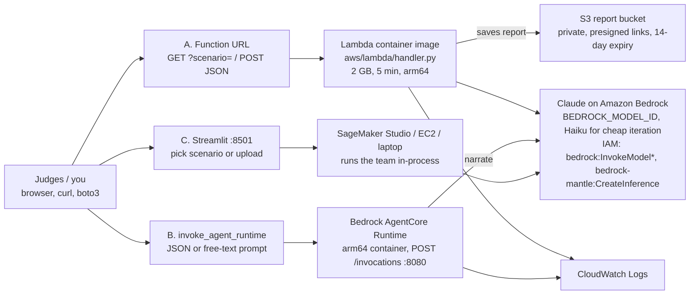

# AWS infrastructure

How CareRelay runs on AWS, structured from the two diagrams in this folder: [`aws_architecture_1.png`](aws_architecture_1.png) (deployment lanes) and [`agent_architecture_1.png`](agent_architecture_1.png) (the care-team pipeline the compute runs). Everything described here lives under [`aws/`](../aws/README.md). Back to [README](../README.md).

## One entry point, three lanes

Every lane calls the same function, `carerelay.service.handle(request)`, and gets back the same report. Pick one lane for the demo.



| Lane | Entry point | Compute | Best for | Setup time |
|---|---|---|---|---|
| **A** shareable API | Lambda Function URL (`GET ?scenario=case_001`, `POST` JSON) | Lambda container image, 2048 MB, 300 s, arm64 | Judges get a link they can open; reports persist in S3 | ~20 min (ECR push + stack) |
| **B** managed agent hosting | `aws bedrock-agentcore invoke-agent-runtime` | AgentCore Runtime, arm64 container on `:8080` | Shows the agent hosted on AgentCore, the sponsor stack | ~25 min (needs lane A's role or the starter-kit role) |
| **C** live demo UI | Streamlit on `:8501` | SageMaker Studio, EC2 or a laptop, in-process | Fastest to set up; file upload and scenario picker | ~5 min |

Recommendation from the diagram: C is fastest, A gives judges a link, B shows AgentCore. Build C first, then A, then B if time allows.

## Request and report contract

```jsonc
// request (all lanes)
{"scenario": "case_001"}                                    // bundled synthetic case, or
{"inputs": {"history_pdf": "<path | base64>", "labs_pdf": "...", "radiology_pdf": "...",
            "intake": {"medications": [...], "history": [...], "allergies": [...]}},
 "options": {"llm": true, "model_id": "us.anthropic...", "region": "us-east-1"}}

// report
{"version": "0.1.0", "case_id": "case_001",
 "stages": {"history": {"status": "ok", "profile": {...}, "markdown": "..."},
            "lab": {"status": "not_implemented", "input_present": true}, ...},
 "report": {"markdown": "# CareRelay report ..."},
 "disclaimer": "...", "elapsed_seconds": 9.4,
 "saved": {"bucket": "...", "links": {"json": "https://...", "md": "https://..."}}}   // lane A only
```

Lane B also accepts `{"prompt": "run case_005"}`; the prompt must name a scenario or be JSON. All lanes also accept `"inputs": {"documents": ["<base64 pdf>", ...]}` for unlabelled uploads: `service.classify_pdf` sorts them into history, labs and radiology by their first page, which is what the drag-and-drop portal page uses (`aws/streamlit/portal.py`, runbook in [DEMO.md](DEMO.md)). Stages that are not built yet report `not_implemented`, so the pipeline view stays honest while the team fills in Lab, Radiology, Summarize, Wellness and Next Steps.

## Components

| Component | Definition | Notes |
|---|---|---|
| Lambda function `carerelay-careteam` | `aws/template.yaml` (`AWS::Serverless::Function`, `PackageType: Image`) | arm64, 2048 MB, 300 s timeout, env `REPORT_BUCKET`, `BEDROCK_MODEL_ID`, `PRESIGN_SECONDS`, `CARERELAY_DATA_DIR=/var/task/data` |
| Function URL | `FunctionUrlConfig` on the function | `AuthType` parameter: `NONE` for a judge-openable link, `AWS_IAM` to require SigV4. CORS allows GET and POST |
| S3 report bucket | `carerelay-reports-<account>-<region>` | Public access blocked, SSE-S3, TLS-only bucket policy, lifecycle expires `reports/` after 14 days. Presigned links max out at 7 days (SigV4 limit), which is why `PresignSeconds` defaults to 604800 |
| Bedrock invoke policy | `BedrockInvokePolicy` managed policy, mirrored in `aws/iam-bedrock-policy.json` | `bedrock:InvokeModel`, `InvokeModelWithResponseStream`, `Converse`, `ConverseStream`, `bedrock-mantle:CreateInference`, plus `comprehendmedical:Infer*` for the coding cascade. Attach it to any other role that runs the agents (SageMaker execution role, EC2 instance role) |
| Lambda role | `CareRelayFunctionRole` | Basic execution + Bedrock policy + `s3:PutObject/GetObject` on `reports/*` only |
| AgentCore execution role | `AgentCoreExecutionRole` (`carerelay-agentcore-execution-<region>`) | Trusts `bedrock-agentcore.amazonaws.com` scoped to the account; ECR pull, logs, X-Ray, workload identity, Bedrock policy, report bucket |
| AgentCore Runtime `carerelay_careteam` | `aws/scripts/deploy_agentcore.sh` (`create-agent-runtime` / `update-agent-runtime`) | Container artifact from ECR, `networkMode PUBLIC`, env `BEDROCK_MODEL_ID`. Not in CloudFormation because the runtime needs the image pushed first |
| ECR repositories | `carerelay-lambda`, `carerelay-agentcore` | Created by `build_push.sh` if missing; scan on push, AES256 |
| CloudWatch | `/aws/lambda/carerelay-careteam` (14-day retention); AgentCore writes its own log group | Each request logs case id, elapsed time and stage statuses |

## Deployment flow

```text
docker buildx (linux/arm64) ──► ECR ──► aws cloudformation deploy aws/template.yaml ──► Lambda + URL + S3 + IAM   (lane A)
docker buildx (linux/arm64) ──► ECR ──► create-agent-runtime --role-arn <stack output>                             (lane B)
pip install -e ".[dev]"     ──► streamlit run aws/streamlit/app.py                                                  (lane C)
```

```bash
export AWS_REGION=us-east-1
export BEDROCK_MODEL_ID=$(aws bedrock list-inference-profiles --region $AWS_REGION \
    --query "inferenceProfileSummaries[?contains(inferenceProfileId,'claude')].inferenceProfileId | [0]" --output text)

make -C aws validate            # cfn-lint locally (ValidateTemplate needs an IAM permission the workshop role may lack)
make -C aws invoke-local        # no AWS: runs case_001 through service.handle
make -C aws streamlit           # lane C
make -C aws push                # both images to ECR
make -C aws deploy-lambda       # lane A, prints FunctionUrl and the AgentCore role ARN
aws/scripts/invoke.sh lambda case_001
make -C aws deploy-agentcore    # lane B, prints AGENT_RUNTIME_ARN
aws/scripts/invoke.sh agentcore <arn> case_005
make -C aws clean               # delete runtime, empty bucket, delete stack and ECR repos
```

`sam deploy` works too, but is not required: `aws cloudformation deploy --capabilities CAPABILITY_IAM CAPABILITY_NAMED_IAM CAPABILITY_AUTO_EXPAND` applies the SAM transform server-side, which matters in a workshop account where the SAM CLI may not be installed. The starter kit's `agentcore configure/deploy` CLI is an alternative for lane B; do not mix it with the scripts here in the same environment.

## Verified locally (2026-10-23)

- Both images build for `linux/arm64`: Lambda image 874 MB (`public.ecr.aws/lambda/python:3.12`), AgentCore image 372 MB (`python:3.12-slim`).
- Lambda image run under the Runtime Interface Emulator: `GET ?scenario=case_001&llm=0` returns 200 with the History stage `ok` and the other stages `not_implemented`; an unknown scenario returns 400.
- AgentCore image: `GET /ping` reports `Healthy`; `POST /invocations` accepts both `{"scenario": ...}` and `{"prompt": "run case_006 parse only"}`.
- `cfn-lint` passes on `aws/template.yaml`. The AWS-side `ValidateTemplate` call and a real deploy were not run.

## Workshop account caveats

- The participant role must allow `iam:CreateRole`, `iam:PassRole`, `ecr:*` on the two repos, `cloudformation:*` on the stack, `lambda:*`, `s3:*` on the report bucket and `bedrock-agentcore-control:*`. If `cloudformation deploy` fails on IAM, deploy lane C only and run the agents with the role Workshop Studio already gave the IDE.
- `BedrockModelId` must be on the account allowlist. The default is Claude Sonnet 4.5, verified on a personal account; the kit's default is a GPT profile. See [AWS_SETUP.md](AWS_SETUP.md) section 3.
- Function URL with `AuthType NONE` is public. The pipeline only ever processes bundled synthetic cases or files the caller uploads, and the bucket stays private behind presigned links, but set `FUNCTION_URL_AUTH=AWS_IAM` if the event rules require it.
- CLI credentials from Workshop Studio expire after 60 minutes; `docker login` to ECR has to be repeated after a refresh.
- Comprehend Medical needs `comprehendmedical:Infer*`; without it the coding cascade falls back to the Bedrock coder and records a warning. The stack's policy grants it.

## The care-team pipeline the compute runs

`agent_architecture_1.png` shows the staged team that `service.handle()` is meant to orchestrate. It uses the Track 1 persona names; the mapping to the CareRelay design in [ARCHITECTURE.md](ARCHITECTURE.md) is:

| Diagram | Stage | CareRelay equivalent | Status |
|---|---|---|---|
| Inputs: lab results, EKG lead II, chest X-ray, patient profile | 0 | Lab PDF, radiology report PDF, medical history PDF, intake answers (EKG optional for Track 1) | History done; others pending |
| Lab Analyst (flags vs reference ranges, eGFR, CKD stage, anaemia, EKG rhythm) | 1, parallel | Lab Agent | pending |
| Radiologist (segmentation, cardiothoracic ratio, zone opacity, abstains if unreadable) | 1, parallel | Radiology Agent | pending |
| Patient profile (meds, allergies, vitals) as context | 1, parallel | History Agent (`HistoryProfile`, risk flags) | **done** |
| Doctor (diagnoses with certainty, triage, draft Rx with allergy, renal and interaction checks; every Rx is a draft for clinician sign-off) | 2 | Summarize node plus critic, expected-vs-incidental rule, red-flag interrupt | pending |
| Nutritionist (kcal, macros, diet rules per condition, food-drug interactions) | 3, parallel | Wellness Agent, nutrition half | pending |
| Physiotherapist (readiness gates, intensity, phased plan, stop signs) | 3, parallel | Wellness Agent, physio half | pending |
| Team huddle (cross-checks plans, e.g. urgent triage caps exercise) | 4 | Critic pass and human-confirmation gate; Next Steps (Insurance + Scheduling) runs alongside | pending |
| Patient report (HTML, Markdown, JSON) | 4 | `report.markdown` plus per-stage JSON in `stages` | done (shape) |
| CareTeam orchestrator and CaseFile blackboard | all | Strands Graph with the shared `CaseRecord` and incidental ledger | pending |
| Claude on Bedrock, optional: wording only, never changes findings, drugs or doses | all | Same rule here: deterministic parsers and rule tables decide, the model narrates (see History Agent) | in place |

The diagram's safety principle is the one this repo already follows: structured findings drive every decision, so the safety rules run whether the model is on or off. Example from the diagram: an eGFR of 36 makes the Doctor halve metformin; potassium of 5.4 defers an ARB and makes the Nutritionist swap spinach for lower-potassium iron sources.

## Cost at hackathon scale

Lambda arm64 at 2 GB for a 10 s request costs well under a cent; AgentCore Runtime bills per second of vCPU and memory while a request runs; the S3 bucket holds kilobytes; Bedrock dominates and a Sonnet 4.5 History run is a few cents. Run `make -C aws clean` before leaving the event.
