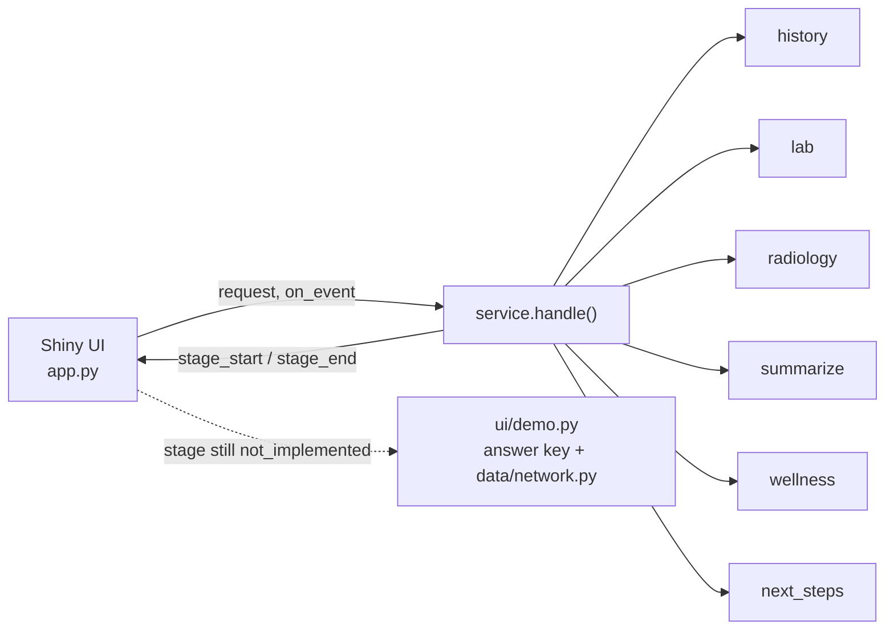

# Frontend: the patient UI and how agents plug in

The patient-facing UI is a Shiny for Python app in [src/carerelay/ui/](../src/carerelay/ui/). It runs `service.handle()` and draws the run as an **agent course**: every agent is a numbered control on a purple route, the handoff log lists what each agent passed to the next, and the result panel shows the incidental ledger, proposed appointments and while-you-wait options. Back to [README](../README.md). Visual rules: [DESIGN.md](../DESIGN.md).

```bash
uv pip install --python .venv/bin/python -e ".[dev,ui]"
.venv/bin/shiny run src/carerelay/ui/app.py           # or the Run App button in Positron
```

All seven agents now run for real. The `Fill agents not built yet with demo data` switch only matters if a stage comes back `not_implemented` (for example while an agent is being reworked): it fills that stage from the answer key and mock network tools, labelled "Done (demo data)".

## How it fits together



| File | Role |
|---|---|
| `ui/contracts.py` | The agent map (`AGENTS`: name, task, what it hands over, to whom) and the Pydantic payload each unbuilt stage must return |
| `ui/pipeline.py` | Calls `service.handle(request, on_event=...)`, turns progress into `stage_start`, `stage_end` and `handoff` events, fills unbuilt stages when demo is on |
| `ui/demo.py` | Demo payloads for unbuilt stages; also a reference implementation of each contract |
| `ui/views.py` | Pure functions: events and report to HTML (course map, task table, handoff log, results) |
| `ui/app.py` | Shiny app: runs the pipeline in a worker thread, polls events every 0.2 s |
| `ui/www/tokens.css` | Generated from [design/tokens.json](../design/tokens.json); never edit by hand |
| `ui/www/course.css` | The Course theme |

`service.handle(request, on_event=None)` is unchanged for the Lambda, AgentCore and Streamlit lanes; `on_event` is optional.

## Plugging in an agent

The UI reads `report["stages"][<stage>]`. To make your agent appear on the course with real output:

1. In `service.handle()`, replace the `not_implemented` placeholder for your stage with a real call, wrapped like the history stage:
   ```python
   t0 = time.time()
   _emit(on_event, "stage_start", "summarize")
   out = run_summarize(...)                                   # your agent
   stages["summarize"] = {"status": "ok", **out.model_dump(), "elapsed_seconds": round(time.time() - t0, 2)}
   _emit(on_event, "stage_end", "summarize", status="ok", elapsed_seconds=stages["summarize"]["elapsed_seconds"])
   ```
   On failure use `status: "needs_clinical_reevaluation"` with an `error` (the course draws it red); never raise.
2. Make the payload match the contract below (`contracts.payload(stage, stage_dict)` shows where the UI looks). `tests/test_ui.py` validates every stage against it for all 10 cases.
3. That is all. With `status: "ok"` the pipeline skips the demo for that stage, and later demo stages consume your real output (for example Wellness already filters OTC options using the real History Agent's allergies).

| Stage | Agent(s) | Payload the UI reads | Contract |
|---|---|---|---|
| `history` | History | `stages["history"]["profile"]` | `carerelay.history.schema.HistoryProfile` |
| `lab` | Lab | `stages["lab"]["result"]["findings"]` | `carerelay.schemas.LabFindings`; UI reads `FindingView` fields |
| `radiology` | Radiology | `stages["radiology"]["result"]["findings"]` incl. `in_impression` | `carerelay.schemas.ImagingFindings` |
| `summarize` | Summarize | `stages["summarize"]["case_record"]` | `CaseRecord`; `contracts.summarize_view()` turns it into the patient ledger |
| `wellness` | Wellness | `stages["wellness"]["result"]["plan"]` | `WellnessPlan` (`carerelay/wellness/rules.py`); UI reads the `WellnessView` subset |
| `next_steps` | Next Steps + Insurance | `stages["next_steps"]["plan"]["steps"]` | Next Steps plan; `contracts.next_steps_view()` maps steps to appointments and Insurance checks |

Insurance has no stage of its own: Next Steps records each propose-and-check round trip in `insurance_checks` (`round`, `provider`, `in_network`, `verdict: accepted | re-propose`, `note`), and the UI animates those as the Next Steps and Insurance handoff loop. Appointments stay `status: "proposed"` until the patient confirms in the UI.

### Live progress inside an agent

`stage_start` and `stage_end` are enough for the course. If an agent wants to narrate finer steps (each Insurance round, say) while it runs, emit them through the same callback from inside `service.handle()`; `pipeline.relay` passes any event with `type` and `stage` through to the UI.

## Handoff wording

`pipeline.describe()` writes one line per handoff from the payload, for example `HistoryProfile: 7 conditions, 2 meds, 1 allergies; risk flags: hyperlipidemia, prediabetes`. When a new agent adds a field worth showing, extend `describe()` for its stage.

## Rules for UI work

- Colours, fonts and sizes come from `design/tokens.json`; after editing it run `python design/build_tokens.py` (tests fail if the generated files are stale). The deck reads the same tokens.
- Keep the patient's question first: headline, then what was found, then the course of appointments. On phones the result renders above the agent course.
- Every number on screen comes from an agent or a tool, never typed in. Demo values are labelled.
- Nothing is booked without the patient: no auto-confirm.
- Design guidance: the [Impeccable](https://impeccable.style/) skill. Install it with `npx skills add pbakaus/impeccable`, then run `/impeccable critique src/carerelay/ui` or `/impeccable polish` after UI changes. It reads [PRODUCT.md](../PRODUCT.md) and [DESIGN.md](../DESIGN.md).
